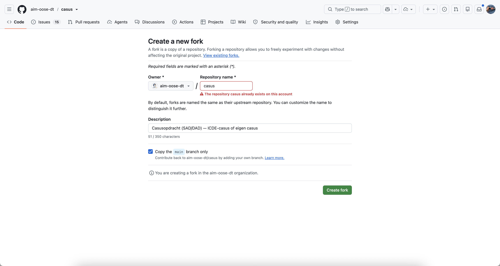

# OOSE-DT — Casusopdracht

Dit is de opdrachtrepository voor de module **OOSE Deeltijd** (Object-Oriented Software Engineering), studiejaar 2026/2027. Je werkt in teamverband aan een casus die over beide blokken loopt: **SAD** (Software Analysis & Design, blok 1) en **DAD** (Distributed Application Development, blok 2). Deze repository fork of clone je (binnen de GitHub-organisatie [aim-oose-dt](https://github.com/aim-oose-dt)) om met de casus te starten.

> De casus bestaat uit beroepsproductdelen B_Casus1 (SAD) en B_Casus2 (DAD).

## De opdracht

Je kiest als team tussen twee opties:

1. De standaard **ICDE-casus** (Integrated Course Design Environment).
2. Een **eigen casus** die voldoet aan de generieke eisen.

> Oorspronkelijke opdracht in Brightspace: https://leren.han.nl/d2l/home/110865
>
> - ICDE-casus: https://leren.han.nl/d2l/le/lessons/110865/topics/895841
> - Eigen casus (eisen): https://leren.han.nl/d2l/le/lessons/110865/topics/895844

## Optie 1: Standaardcasus ICDE

**Auteurs/opdrachtgevers:** Christian Köppe en Rody Middelkoop.

### Inleiding

De auteurs hebben het OOSE-deeltijdsemester ontwikkeld met behulp van Educational Patterns en Assessment-Driven Course Design. Ze zijn begonnen bij de leeruitkomsten en hebben van daaruit de beoordelingsdimensies en -criteria (rubrics) bepaald, gevolgd door een planning van toetsmomenten. Daaruit is een lesplanning met bijbehorende didactiek afgeleid, waarbij Hybrid Pedagogy en Constructive Alignment zijn toegepast en beoordelingscriteria expliciet aan lesinhoud zijn gekoppeld.

Tijdens dit strikte proces liepen ze tegen een aantal problemen aan:

- Er waren meerdere, onderling inconsistente formaten voor OWE-beschrijvingen in gebruik.
- Er was geen duidelijk format voor beoordelingscriteria of voor de lesplanning.
- Er was geen eenvoudig overzicht om te controleren of alle leeruitkomsten voldoende werden afgedekt.

De handmatige consistentiecontroles bleken foutgevoelig. Hybride aspecten zoals Iterative Grading dreigen bovendien een foutgevoelige administratie met veel overhead op te leveren.

### Opdrachtbeschrijving

In plaats van talloze losse Word- en Excel-bestanden bouw je een systeem dat de administratieve delen van het cursusontwikkelproces ondersteunt: het bewaart de data en genereert daaruit de benodigde documenten. Het systeem ondersteunt of bevat de volgende features:

- collaboratief werken zonder versiebeheerproblemen;
- scheiding van inhoud en vorm, waarbij formaten worden gegenereerd en eenvoudig aanpasbaar zijn;
- geautomatiseerde detectie van inconsistenties, bijvoorbeeld onvoldoende onderwijs per beoordelingsdimensie, of lessen die niet bijdragen aan de leerdoelen;
- data die direct bruikbaar is voor nieuwe aanpakken zoals Iterative Grading, waarbij transparantie en de groei van de student centraal staan;
- vereenvoudigd delen van onderwijsonderdelen tussen opleidingen en profielen;
- flexibiliteit in formaten, algemene ontwerpaanpak en uitbreidbaarheid, zodat het HAN-breed inzetbaar is;
- koppeling op termijn met andere systemen, zoals een leeromgeving (genereren en plaatsen van modulebeschrijvingen) of een studentinformatiesysteem (eindbeoordelingen volgens rubrics overnemen, inclusief onderbouwing).

### De opdracht (deliverables)

Maak een analyse en leg deze vast in een requirements-specificatie. Ontwerp het systeem volgens die specificatie en realiseer een prototype dat aantoont dat de belangrijkste requirements gerealiseerd (kunnen) worden. Toon van alle onderdelen aan dat ze van voldoende kwaliteit zijn. Gebruik de actuele beoordelingscriteria in de Brightspace-omgeving van SAD of DAD, passend bij het casusdeel dat je laat beoordelen.

> Je mag op elk moment tijdens de uitvoering onderdelen laten beoordelen, mits je (1) duidelijk aangeeft op welke criteria je welk niveau denkt te halen (zie rubrics), en (2) onderbouwt waarom, met een link naar die onderbouwing. Zonder onderbouwing geen beoordeling.

## Optie 2: Eigen casus

Je mag ook een eigen casus ontwerpen. Deze moet voldoen aan de volgende eisen:

- Domeinmodel met minimaal 10 concepten.
- Use case diagram met minimaal 10 use cases, waarvan maximaal 65% CRUD.
- Een op zichzelf staand (onderdeel van een) systeem — dus geen features toevoegen aan of bugs oplossen van een bestaand systeem.
- Het systeem is distribueerbaar over meerdere machines/nodes (geen monoliet): presentatielaag, domeinlaag en datalaag draaien op verschillende servers. Een mobiele app of JavaScript front-end via RESTful services op een backend met een aparte database voldoet al.
- De technologiekeuze is nog niet volledig bepaald, met voldoende keuzevrijheid om deze gemotiveerd te onderbouwen.
- De casus kan tussentijds aangevuld worden met functionele en niet-functionele eisen vanuit de opdrachtgever (docent).

### Tips voor een eigen casus

- Beschrijf de meerwaarde voor jezelf of je werkgever: waarom moet dit gebouwd worden en welk probleem lost het op?
- Beschrijf features, user stories of use cases. Focus op features met logica, rekenwerk of complexiteit (veel samenwerking tussen objecten), niet op pure CRUD of UI. Een app die alleen leest en schrijft naar een database legt de focus te veel op UI en opslag — beide vallen buiten de OOSE-leerstof.
- Een eenvoudige database (~10 tabellen) en een sobere UI (witte schermen, grijze knoppen) houden de focus op functionaliteit.
- Neem een voorschot op prioriteiten: een goede casus is te groot voor de beschikbare tijd, zodat je keuzes maakt en in delen oplevert.
- Noem ook niet-functionele eisen: externe systemen en APIs, schaalbaarheid, flexibiliteit (vervangbare libraries), en het gewenste platform of de gewenste taal.
- Neem een voorlopig lijstje concepten op als quickstart voor het domeinmodel, inclusief hun samenhang: meer samenhang betekent meer kans dat het samenwerkende klassen worden.
- Overleg met de docenten over de technologie. Java is de OOSE-huisstijl, maar C#, TypeScript of Python mag ook, mits je de OOSE-ontwerpprincipes en patterns kunt toepassen.

## Werkwijze GitHub-repo

Voor een docent is het prettig als de namen van de studenten direct in de repo-naam staan. Daarom plaatsen we de studentnamen vooraan, gevolgd door de naam van de casus. Gebruik duidelijke, consistente naamgeving met kleine letters en streepjes, zodat de repository eenvoudig, leesbaar en makkelijker te herkennen is voor zowel docent als beoordelaar.

Een goede naamgeving ziet er als volgt uit:

casus-abdullah-ali-smart-charging-scheduler
casus-jan-jansen-maria-van-der-berg-smart-charging-scheduler
casus-<voornaam>-<achternaam>-<student-2>-<student-3>-<casusnaam>
Gebruik altijd kleine letters en streepjes in plaats van spaties, underscores of hoofdletters. Dit maakt de naam beter leesbaar, beter compatibel met verschillende platforms en consistent met gangbare conventies voor URL- en repo-namen. De prefix casus- maakt direct duidelijk dat het om een casusopdracht gaat.

Bij het opzetten van de repository geldt het volgende:

Maak een nieuwe repository aan, tenzij er een duidelijke reden is om te forken. Geef de repo een naam volgens het patroon: `casus-<student1>-<student-2>-<student-3>-<casusnaam>`.

Bijvoorbeeld `casus-john-gert-jan-deborah-icde` of `casus-alice-yusuf-bert-slimme-kledingkast`

Voeg teamgenoten direct toe als collaborators.
Pas de README.md meteen aan en vul deze volledig in voor het eigen project.

Houd de naamgeving consistent gedurende het project, zodat links, beoordeling en begeleiding eenvoudig blijven.
Deze werkwijze is niet alleen praktisch voor docenten, maar ook voor de lange termijn: korte, duidelijke en goed leesbare repo-namen helpen bij overzicht, vindbaarheid en professionele communicatie.

Laat de startplanning automatisch aanmaken nadat de repository vanuit deze template is gemaakt. Hiervoor bevat de repository een handmatig startbare GitHub Actions-workflow. Deze wordt niet bij iedere commit uitgevoerd en gebruikt alleen Actions-minuten wanneer iemand hem bewust start.

1. Open in GitHub het tabblad **Actions**.
2. Kies de workflow **Project starten**.
3. Klik rechts op **Run workflow**.
4. Laat de standaardbranch geselecteerd en klik in het geopende venster nogmaals op **Run workflow**.
5. Open de workflowrun en wacht tot **Maak milestones en issues** groen is.
6. Controleer daarna de aangemaakte Issues, Labels en Milestones.

De knop **Run workflow** is beschikbaar zodra de workflow op de standaardbranch staat. Je hebt schrijfrechten op de repository nodig om hem te starten. Staat er bij de eerste keer openen van **Actions** een knop om workflows in te schakelen, schakel GitHub Actions dan eerst in.

De workflow maakt de startissues en bijbehorende milestones aan. Bestaande issues en milestones worden bij een nieuwe uitvoering overgeslagen. Pas daarna de planning aan jullie casus aan:

- wijs teamleden toe via **Assignees**;
- vul de acceptatiecriteria en kwaliteitsonderbouwing per issue aan;
- pas de streefdata in de issue-tekst en de deadlines van milestones aan op jullie planning;
- houd de voortgang zichtbaar via een GitHub Projects-board.

## Bijlagen

- `sad/casus-opdracht.md` — EVL-beschrijving en leeruitkomsten
- `sad/toetsing/beoordelingscriteria casus.xlsx` — beoordelingscriteria
- `sad/assets/OOSE DT Casus ICDE.docx` — volledige ICDE-casusbeschrijving

---

## Bronnen

- Cutts, M. (2011, 22 november). *Underscores vs. dashes in URLs [Video]*.* YouTube. https://www.youtube.com/watch?v=AQcSFsQyct8

- Google. (z.d.). *URL structure.* In Google Search Central. https://developers.google.com/search/docs/crawling-indexing/url-structure

Microsoft. (z.d.). *Cross-platform compatibility. In Azure Repos documentation*. https://learn.microsoft.com/en-us/azure/devops/repos/git/os-compatibility

Province of British Columbia. (z.d.). *Naming repositories. In GitHub*. https://github.com/bcgov/BC-Policy-Framework-For-GitHub/blob/master/BC-Gov-Org-HowTo/Naming-Repos.md
